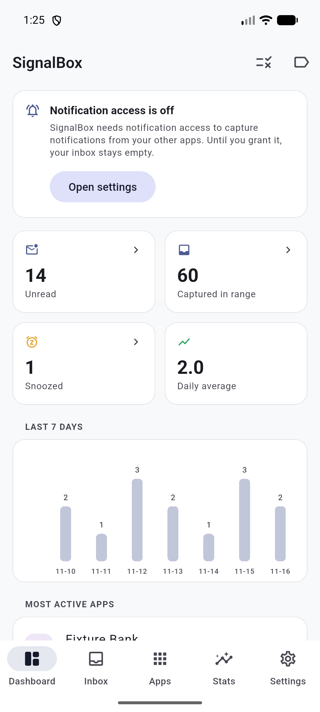
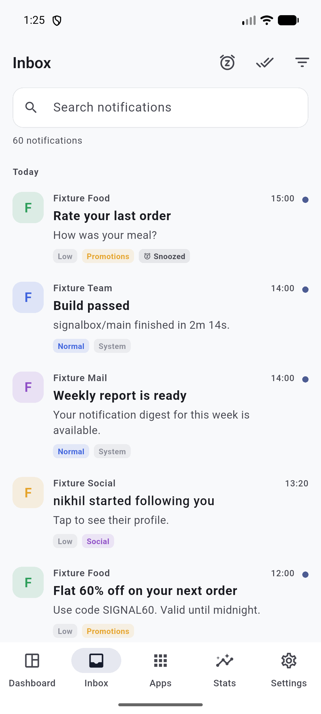
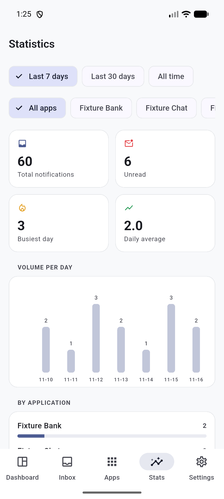
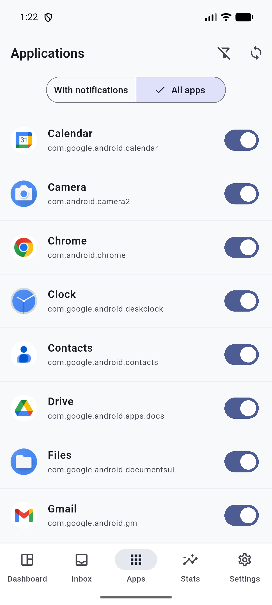
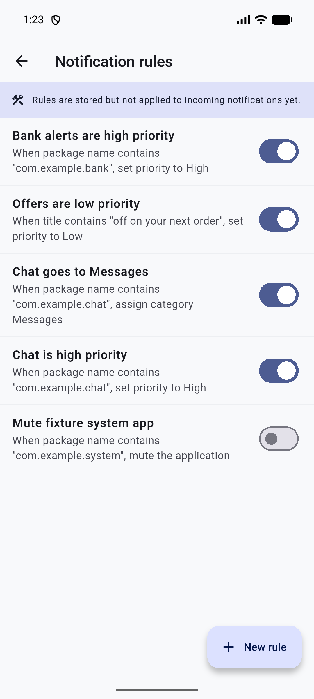
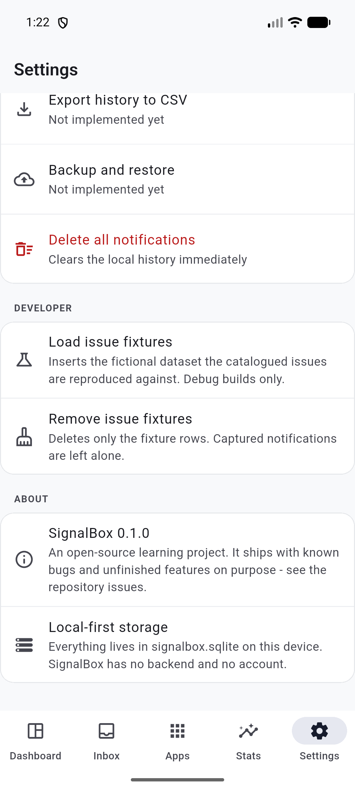

# SignalBox

**Smart notification management for Android, built with Flutter.**

SignalBox captures the notifications your other applications post, keeps them in
a searchable local history, groups them by application and priority, and shows
you what is actually making your phone noisy.

> ### Read this before you judge the code
>
> SignalBox is an **open-source collaboration and learning project**. It has a
> working foundation and a professional UI, and it also contains **12 deliberately
> seeded bugs**, **10 intentionally unfinished features** and **5 code-quality
> tasks**, all catalogued and all tracked as issues.
>
> This is on purpose. The repository exists so that contributors can practise a
> realistic workflow: pick an issue, reproduce it, fix it, add a regression test,
> open a pull request, get reviewed, and merge through CI.
>
> - Every known defect is listed in [`docs/SEEDED_BUGS.md`](docs/SEEDED_BUGS.md)
> - Every gap is listed in [`docs/MISSING_FEATURES.md`](docs/MISSING_FEATURES.md)
> - The `main` branch builds, launches, analyzes clean and passes all 124 tests
>
> Do not use SignalBox as a finished product, and do not take the seeded bugs as
> examples of good practice.

## Problem statement

A busy Android phone produces hundreds of notifications a day. The system shade
shows them once, in one flat stream, and then they are gone. There is no history,
no search, no way to see which application is responsible for a third of your
interruptions, and no way to decide what deserves your attention later.

Most apps that try to solve this want an account and upload your notification
content to a server, which for notifications (messages, OTPs, bank alerts) is
exactly the wrong trade. SignalBox is local-first: everything stays in one SQLite
file on the device, and there is no backend to send it to.

## Features

Working today:

- **Notification inbox** with date grouping, swipe-to-archive and per-item actions
- **Full history** kept locally in SQLite
- **Real device applications**: the app list is read from the Android package manager, with launcher icons - nothing is hard-coded
- **Application-wise grouping** with per-app totals, unread counts and last activity, plus an *All apps* view for muting an app before it ever notifies
- **Search and filtering** by application, priority, category, read state and date range
- **Priority categorisation** (high / normal / low), editable per notification
- **Categories**: five system buckets (Messages, Social, Finance, Promotions, System)
- **Custom rules**: create, edit, enable and delete rules *(stored but not yet applied — see `F2`)*
- **Statistics**: volume per day, breakdowns by application, category and priority, daily average, busiest day
- **Snooze and reminders** with presets and a dedicated Snoozed screen
- **Privacy settings**: preview masking, retention window, delete-all
- **Android notification capture** through a Kotlin `NotificationListenerService`, stored as it arrives
- **Light and dark themes**, Material 3, following the system by default

Deliberately incomplete: CSV export, the rule evaluation engine, custom
categories, bulk selection, daily summaries, backup and restore, retention
enforcement, inbox grouping by app, per-app analytics, search improvements. Each
one is scoped in [`docs/MISSING_FEATURES.md`](docs/MISSING_FEATURES.md) and the
interface says plainly where a feature is missing instead of pretending it works.

### Platform support

| Platform | Status |
| --- | --- |
| Android | Supported. Notification capture via the system notification listener, and the installed-app list via the package manager. |
| iOS | Builds and runs, **without** notification capture or installed-app discovery. iOS has no public API for either. The inbox stays empty. |

SignalBox will not claim iOS parity it cannot have. On any platform without a
notification-listener API the dashboard says so in a banner.

## Screenshots

The **Applications** screen below is real: those are the emulator's own
installed apps and their real launcher icons. The other screens are shown with
the developer fixtures loaded, because SignalBox ships no sample data and a
fresh install is empty by design. See
[`docs/screenshots/README.md`](docs/screenshots/README.md).

| Dashboard | Inbox | Statistics |
| --- | --- | --- |
|  |  |  |

| Applications | Rules | Settings |
| --- | --- | --- |
|  |  |  |

## Technology stack

| Concern | Choice |
| --- | --- |
| UI | Flutter 3.38, Material 3 |
| Language | Dart 3.10, Kotlin (Android platform code) |
| State management | Riverpod 2 (`Notifier` / `AsyncNotifier`) |
| Routing | go_router 14 |
| Persistence | SQLite via `sqflite`, hand-written SQL, no code generation |
| Preferences | `shared_preferences` |
| Formatting | `intl` |
| Charts | hand-rolled widgets, no charting dependency |
| Tests | `flutter_test`, `sqflite_common_ffi` |
| CI | GitHub Actions |

Eight runtime dependencies. A new dependency needs a justification in the pull
request.

## Architecture

Feature-first, with `data` / `domain` / `presentation` inside each feature:

```
lib/
  core/        constants, database, errors, extensions, router, services, theme
  features/    dashboard, notifications, applications, categories, rules,
               statistics, settings
  shared/      models and widgets used by more than one feature
```

The database handle and the preferences instance are opened in `main()` and
injected through `ProviderScope` overrides, so every repository provider is
synchronous and every test can swap in an in-memory database.

Read [`docs/ARCHITECTURE.md`](docs/ARCHITECTURE.md) for the data flow, the
Android capture path, the provider ownership table, and why the project uses
hand-written SQL rather than Drift.

## Installation

Prerequisites: Flutter **3.38** or newer (Dart 3.10+), the Android SDK, and JDK 17.

```bash
git clone https://github.com/amanempiricinfotech-hash/SignalBox.git
cd SignalBox
flutter pub get
flutter doctor        # resolve anything it flags for Android
```

## Running

```bash
flutter run                        # pick a device when prompted
flutter run -d <device-id>
flutter build apk --debug          # or --release
```

SignalBox starts **empty**. It contains no sample notifications and no built-in
list of applications: the Applications screen is read from your device's package
manager, and the inbox fills up with your own notifications once you grant
notification access.

In a debug build, **Settings > Developer > Load issue fixtures** inserts a small
fictional dataset. That exists only so the catalogued issues can be reproduced
identically on every machine; it is never loaded automatically and is not
reachable in a release build.

### Enabling real notification capture (Android)

1. Launch the app and open the **Dashboard** tab.
2. Tap **Open settings** on the notification-access banner.
3. Enable **SignalBox** under *Notification access*.
4. Return to the app. New notifications are captured as they arrive.

Android treats notification-listener access as a sensitive permission: it can
only be granted by hand in system settings, and SignalBox cannot request it with
a dialog.

## Testing

```bash
flutter test                                       # 124 tests
flutter test --coverage
dart format --output=none --set-exit-if-changed .  # CI gate
flutter analyze                                    # CI gate
```

Repository tests run against real in-memory SQLite, not mocks. See
[`docs/TESTING.md`](docs/TESTING.md) for the helpers, the widget-test template,
and the one non-obvious detail about the FFI factory.

## Contributing

Contributions are the point of this repository.

1. Browse the [issues](https://github.com/amanempiricinfotech-hash/SignalBox/issues).
   Start with [`good first issue`](https://github.com/amanempiricinfotech-hash/SignalBox/labels/good%20first%20issue).
2. Comment on the issue to get it assigned, so two people do not fix the same bug.
3. Fork, branch, fix, **add the regression test the issue names**, open a PR.

Every issue carries a difficulty label:

| Level | What it needs | Examples |
| --- | --- | --- |
| `beginner` | One file, no need to understand the whole app | `B1`, `B4`, `B6`, `B10`, `F10`, `Q3`, `Q5` |
| `intermediate` | Repository logic, SQL, state management | `B2`, `B3`, `B5`, `B7`, `B8`, `B9`, `B11`, `B12` |
| `advanced` | Kotlin, migrations, background work, performance | `F2`, `F5`, `F6`, `Q1` |

Read [`CONTRIBUTING.md`](CONTRIBUTING.md) for the branch naming, commit
convention, review expectations and the full checklist. Also read
[`CODE_OF_CONDUCT.md`](CODE_OF_CONDUCT.md).

## Current limitations

Be aware of these before filing a bug:

- **Known seeded bugs.** 12 of them, listed in [`docs/SEEDED_BUGS.md`](docs/SEEDED_BUGS.md). Please do not open duplicates.
- **Rules do not run.** They are stored and editable, but nothing applies them to incoming notifications. A captured notification gets Android's own priority hint and no category (`F2`).
- **Android only, for capture and for the app list.** iOS builds but can neither read other apps' notifications nor enumerate installed applications.
- **The inbox starts empty.** SignalBox has no sample data. Until you grant notification access there is nothing to show, by design.
- **No export, no backup.** Your data is in one SQLite file and there is no supported way to move it yet (`F1`, `F6`).
- **Retention is not enforced.** The setting exists; nothing deletes old data (`F7`).
- **No pagination indexes.** Queries are unindexed and will degrade with a very large history (`Q1`).
- **Notifications are captured, not mirrored.** SignalBox cannot dismiss or reply to a notification in the originating app.
- **Phone layouts only.** Nothing adapts to tablets or landscape yet (`Q4`).
- **Partial accessibility.** Some semantics and tap targets are in place, many are not (`Q3`).

## Roadmap

| Milestone | Scope |
| --- | --- |
| **1. Application Foundation** | Architecture, navigation, theme, database, inbox, apps, statistics, settings, CI. **Done.** |
| **2. Bug Fixes** | The 12 seeded bugs, each with a regression test. |
| **3. Missing Features** | The 10 unfinished features, starting with the rule engine and CSV export. |
| **4. Performance and Quality** | Indexes and migrations, rebuild reduction, accessibility, responsive layout, documentation. |
| **5. Stable Release** | No known seeded bugs, no unfinished features in the UI, measured performance, 1.0.0. |

## License

[MIT](LICENSE).

## Acknowledgements

SignalBox exists to be worked on. If you are learning Flutter, fixing a bug here
is a complete exercise: reproduce it, understand the layer it lives in, fix it,
prove it with a test, and defend it in review.
